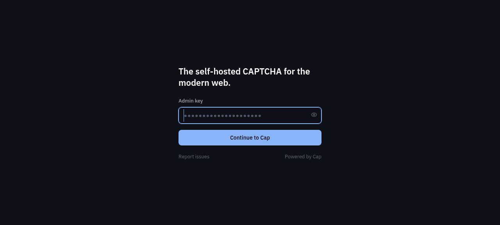

#  cap_ynh

Native (no Docker) YunoHost package for [cap](https://github.com/tiagozip/cap)
— a privacy-first, self-hosted proof-of-work captcha (no puzzles, no
tracking, tiny client). Runs the upstream `standalone` Bun/Elysia server
directly under systemd with a **private per-app redis instance** (own
config, port, and RDB under the app's data dir — the shared system redis
is never touched).

## How it's wired

- **Public surface** (must never hit the portal): `POST /<siteKey>/challenge`,
  `POST /<siteKey>/redeem`, `POST /siteverify`, `/health*`, `/share/<token>`,
  and `/assets/*` when the opt-in asset mirror is on.
- **Admin surface** is double-locked: the YunoHost portal protects
  `/server/*` (key-management API), `/auth/*` and `/public/*` (granted to
  `admins`), and cap's own admin key still guards the dashboard login.
  The root page is public but only ever shows cap's login form, whose
  submit endpoint is portal-gated.
- Root-install only (`path=/`) — cap issues root-absolute redirects.
- The app listens on `127.0.0.1` only; nginx is the sole entrypoint and
  overwrites `X-Forwarded-For` with the true client IP (cap reads it).

## After install

1. Open `https://<domain>/`, log in with the admin key you chose
   (retrieve it later with `yunohost app setting cap admin_key`).
2. Create a **site key** in the dashboard. Embed the widget in your form,
   pinned to the version the package documents (recorded in the
   `widget_version` setting), e.g.:

   ```html
   <script src="https://cdn.jsdelivr.net/npm/@cap.js/widget" defer
     data-cap-sitekey="<SITE_KEY>"
     data-cap-endpoint="https://<domain>/"
     data-cap-action="verify" data-cap-target="/path/to/form-handler"
     data-cap-method="POST" data-cap-theme="light"></script>
   ```

3. Verify server-side from your backend with the site's **secret key**.
   The widget submits the challenge `response` to your form handler; send
   it on unchanged:

   ```
   POST https://<domain>/siteverify
   { "secret": "sk-...", "response": "<siteKey:token:solution from the widget>" }
   ```

   `200 {"success": true}` only for a solved, unexpired, unredeemed
   response (403 wrong secret, 404 unknown/expired token, 409 already
   redeemed).

## Client assets

By default the widget/wasm are served to visitors from the official jsDelivr
CDN (pinned versions). To serve them from your own cap instance instead,
set `assets_server=true` in the app's config panel (the `/assets/` route is
public). You then point the widget's wasm resolution at `https://<domain>/assets/`.

## Upgrade

`yunohost app upgrade cap` re-fetches the pinned sources per the manifest.
To bump cap: change `[resources.sources.main]` url/sha256 + `version`, and
bump the bun asset if needed; `bun install --frozen-lockfile` rebuilds
`node_modules` from the new lockfile.

## Admin notes

- Private redis listens on the booked `$port_redis` (loopback only); state
  is the RDB snapshot in `/home/yunohost.app/<app>/redis/dump.rdb`, backed
  up via BGSAVE on every `yunohost backup create`.
- Config panel: rotate the admin key, toggle the asset mirror, change
  pinned widget/wasm versions.
- If you also proxy the domain through Cloudflare, cap's `CF-Connecting-IP`
  support picks the real IP up automatically (X-Forwarded-For is set by
  nginx regardless).

## Screenshots



